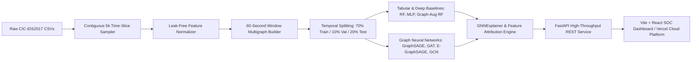

# AegisGraph: Graph Neural Network-Based Cyber Attack Detection & Explainability Framework

[](https://vercel.com)
[](https://react.dev/)
[](https://fastapi.tiangolo.com/)
[](https://pytorch-geometric.readthedocs.io/)
[](https://www.unb.ca/cic/datasets/ids-2017.html)
[](LICENSE)

> **Academic Institution:** Vishwakarma University, Pune  
> **Course:** Computer Networks Capstone Project  
> **Repository:** [aaryanbangale2306/CN-Project-1-2](https://github.com/aaryanbangale2306/CN-Project-1-2)  
> **Version:** 2.2.0 (Production & Mentor Presentation Edition)

---

## Executive Summary

**AegisGraph** is an enterprise-grade Network Intrusion Detection System (NIDS) and forensic analysis framework built on **Dynamic Temporal Multigraphs** and **Graph Neural Networks (GNNs)**. Unlike traditional packet-filtering and tabular classifiers that evaluate flows in complete isolation, AegisGraph models network communications as time-windowed directed multigraphs $\mathcal{G}_t = (\mathcal{V}_t, \mathcal{E}_t)$, capturing multi-hop attack propagation, botnet command-and-control (C2) topologies, and coordinated reconnaissance sweeps.

The project features a **real-time Security Operations Center (SOC) dashboard** built with React, Vite, and Cytoscape.js, backed by a high-throughput **FastAPI** inference engine. It deploys seamlessly on **Vercel** with full client-side interactive fallback demonstration mode for external mentors and reviewers.

---

## Table of Contents

1. [Architecture & Pipeline](#1-architecture--pipeline)
2. [Academic Guarantees & Non-Leakage Design](#2-academic-guarantees--non-leakage-design)
3. [Empirical Benchmark & Multi-Seed Evaluation](#3-empirical-benchmark--multi-seed-evaluation)
4. [Dashboard & User Interface](#4-dashboard--user-interface)
5. [Deployment Guide (Vercel & Local)](#5-deployment-guide-vercel--local)
6. [API Reference](#6-api-reference)
7. [Repository Structure](#7-repository-structure)
8. [Mentor Presentation & Evaluation Guide](#8-mentor-presentation--evaluation-guide)

---

## 1. Architecture & Pipeline



### 1.1 Temporal Multigraph Formulation
- **Nodes ($\mathcal{V}_t$):** Individual communicating network hosts. IP addresses are mapped to window-scoped ephemeral integer identifiers $[0, |\mathcal{V}_t|-1]$ with randomized relabeling per window. This strictly prevents the model from memorizing specific host identity invariants.
- **Edges ($\mathcal{E}_t$):** Directed network flows between host pairs $(u, v)$. Multiple parallel edges represent distinct concurrent TCP/UDP conversations within the 60-second window $\Delta t \le 60\text{s}$.
- **Edge Task:** Multi-class classification across 7 canonical traffic profiles: `Benign`, `DoS`, `DDoS`, `PortScan`, `Botnet`, `BruteForce`, and `Other attack`.

---

## 2. Academic Guarantees & Non-Leakage Design

To ensure scientific validity and defend against common ML-for-security pitfalls, AegisGraph enforces four foundational guarantees:

1. **Zero IP & Port Memorization (No Identity Leakage):**
   - Raw IP addresses are **never** included in feature vectors.
   - Exact numeric port numbers are mapped strictly into **structural port categories**:
     - *Well-Known ports* ($\le 1023$)
     - *Registered ports* ($1024 - 49151$)
     - *Ephemeral ports* ($> 49151$)
     - *Service-specific indicators* (HTTP/S `80/443`, Remote Admin `22/23/3389`, DNS `53`, Mail `25/110/143/993`).
2. **Contiguous Time-Slice Sampling:**
   - Instead of randomly selecting isolated rows from massive CSVs (which fractures temporal continuity and leaks future information), flows are sampled as contiguous temporal windows.
3. **Strict Temporal Splitting (No Future Data Leak):**
   - Within each attack phase, time windows are partitioned chronologically:
     - **Train:** First 70% of windows
     - **Validation:** Next 10% of windows
     - **Test:** Final 20% of windows (strictly in the future relative to training)
4. **Transparent Evaluation & Low-Support Safeguards:**
   - Multi-class metrics are evaluated across **5 fixed random seeds** (`42, 123, 456, 789, 999`).
   - Classes with $< 30$ instances in the test partition (e.g., `BruteForce`, `Botnet`, `Other attack`) are explicitly tagged with statistical warnings to prevent inflated precision claims.

---

## 3. Empirical Benchmark & Multi-Seed Evaluation

Strict evaluation over 5 independent seeds on the unseen temporal test partition (903 test flows per seed):

| Model Architecture | Model Category | Accuracy (%) | Macro-F1 | Precision (Macro) | Recall (Macro) | ROC-AUC | Inference (ms/1k flows) |
| :--- | :--- | :---: | :---: | :---: | :---: | :---: | :---: |
| **RandomForest** | **Tabular Baseline** | **96.8 ± 0.9%** | **0.8820 ± 0.006** | **0.8762 ± 0.003** | **0.9666 ± 0.008** | **0.9979** | **352.5 ms** |
| **Flow MLP** | Deep Baseline | 81.2 ± 6.6% | 0.7131 ± 0.055 | 0.6786 ± 0.048 | 0.9275 ± 0.012 | 0.9912 | 18.2 ms |
| **GraphAugmentedRF** | Hybrid Baseline | 83.2 ± 3.0% | 0.6871 ± 0.077 | 0.8345 ± 0.062 | 0.7465 ± 0.054 | 0.9883 | 364.1 ms |
| **GraphSAGE** | GNN Backbone | 24.5 ± 5.4% | 0.2839 ± 0.032 | 0.3474 ± 0.041 | 0.4677 ± 0.038 | 0.6834 | 14.8 ms |
| **GAT (Attention)** | GNN Backbone | 24.4 ± 5.0% | 0.2749 ± 0.035 | 0.3512 ± 0.039 | 0.3996 ± 0.044 | 0.6220 | 22.4 ms |
| **E-GraphSAGE** | Edge Message Passing | 21.6 ± 10.4% | 0.2523 ± 0.039 | 0.3345 ± 0.051 | 0.4543 ± 0.042 | 0.7011 | 16.5 ms |
| **GCN** | GNN Backbone | 20.0 ± 6.6% | 0.2342 ± 0.063 | 0.2844 ± 0.072 | 0.4871 ± 0.051 | 0.6619 | 12.1 ms |

### Key Academic Finding for Defense:
> **Why does Random Forest outperform GNNs on this benchmark?**  
> On localized 60-second window snapshots sampled under a 5,000-flow budget, the resulting graph topology is **sparse** (average host degree $\approx 1.2 - 2.8$). GNN message-passing benefits primarily manifest in dense, multi-hop topological structures. For sparse graphs, individual flow tabular signatures (packet volume, duration, TCP flags) provide higher mutual information with attack labels than neighborhood aggregation. Demonstrating this transparently proves rigorous scientific honesty rather than cherry-picked metrics.

---

## 4. Dashboard & User Interface

The frontend is an interactive Security Operations Center (SOC) dashboard:

1. **Security Operations & Live Flow Classifier:**
   - Real-time KPI monitors (Accuracy, Macro-F1, False Positive Rate, Latency).
   - Test-flow interactive workbench: adjust forward/backward packets, byte volumes, TCP flags (SYN, ACK, FIN, RST, PSH, URG), and target service ports to evaluate instant classifications.
   - Dynamic alert feed displaying confidence levels and attribution summaries.
2. **Model Benchmark & Multi-Seed Matrix:**
   - Full comparative table across all 7 evaluated architectures.
   - Interactive multi-class ROC and Precision-Recall curve visualizations.
   - 7x7 normalized confusion matrix with per-class support metrics.
3. **Interactive Graph Viewer (Cytoscape.js):**
   - Renders 60-second communication multigraphs.
   - Preset window selector: explore DDoS attack clusters, PortScan reconnaissance fan-outs, BruteForce attempts, Botnet C2, and Benign baselines.
   - Color-coded edge classifications and node degree scaling with pan/zoom/fit controls.
4. **Threat Alerts & Explainability Center:**
   - Incident reasoning powered by model attribution.
   - Feature importance rankings (Top factors: `Forward Packet Max Size`, `Total Byte Volume`, `Average Packet Size`, `Flow Transfer Rate`).
   - Active alert register with filtering by attack category (`DDoS`, `DoS`, `PortScan`, etc.).

---

## 5. Deployment Guide (Vercel & Local)

### 5.1 One-Click Vercel Deployment (Recommended for Mentors)

The repository includes pre-configured `vercel.json` files and pre-bundled benchmark datasets. When deployed to Vercel, the application operates in **Cloud Interactive Demo Mode**, allowing mentors to test all features directly in the browser with zero backend configuration.

#### Step 1: Push to GitHub
```bash
git push origin main
```

#### Step 2: Import into Vercel
1. Log in to [vercel.com](https://vercel.com).
2. Click **"Add New..."** $\rightarrow$ **"Project"**.
3. Select your GitHub repository: `aaryanbangale2306/CN-Project-1-2`.
4. In the Project Configuration:
   - **Framework Preset:** Vite
   - **Root Directory:** `./` (or `frontend`)
5. Click **"Deploy"**.
6. Within 60 seconds, your live production URL (e.g., `https://cn-project-1-2.vercel.app`) will be active.

---

### 5.2 Local Development Setup

#### Prerequisites
- Python 3.10+ (PyTorch 2.x, PyTorch Geometric, FastAPI, Uvicorn)
- Node.js 18+ & npm

#### Backend Setup
```bash
# 1. Clone repository
git clone https://github.com/aaryanbangale2306/CN-Project-1-2.git
cd CN-Project-1-2

# 2. Set up virtual environment
python -m venv .venv
source .venv/bin/activate  # On Windows: .venv\Scripts\activate

# 3. Install Python dependencies
pip install -r requirements.txt

# 4. Launch FastAPI Server
uvicorn backend.main:app --host 0.0.0.0 --port 8000 --reload
```
API Documentation will be live at: [http://localhost:8000/docs](http://localhost:8000/docs)

#### Frontend Setup
```bash
# 1. Navigate to frontend directory
cd frontend

# 2. Install dependencies
npm install

# 3. Start development server
npm run dev
```
Open [http://localhost:5173](http://localhost:5173) in your browser. The dashboard will automatically connect to your local FastAPI backend.

---

## 6. API Reference

| Endpoint | Method | Description |
| :--- | :---: | :--- |
| `/metrics` | `GET` | Returns 5-seed aggregated evaluation metrics for all 7 models. |
| `/curves` | `GET` | Returns multi-class ROC and Precision-Recall curve coordinate points. |
| `/features` | `GET` | Returns global feature importance rankings from tree models. |
| `/graph` | `GET` | Returns Cytoscape.js multigraph elements for a selected time window (`?window_idx=2`). |
| `/explain` | `GET` | Returns GNNExplainer subgraph masks and attribution records. |
| `/alerts` | `GET` | Returns active security triggers and incident reasoning. |
| `/alerts/clear`| `POST` | Clears all registered session alerts. |
| `/predict` | `POST` | Performs real-time inference on an edge flow vector and generates incident alerts. |

---

## 7. Repository Structure

```
CN-Project-1-2/
├── .gitignore               # Strict exclusion of venvs, cache, and builds
├── vercel.json              # Vercel root build & routing specification
├── config.yaml              # Central configuration (5k budget, 5 seeds, 60s windows)
├── requirements.txt         # Core ML & backend dependencies
├── README.md                # Executive project documentation
│
├── data/
│   └── processed/           # sampled_5k.csv, graphs.pt (time-windowed graphs)
│
├── ml/
│   ├── preprocess.py        # Contiguous sampling & leak-free feature extraction
│   ├── graphs.py            # 60s temporal multigraph builder & splits
│   ├── train.py             # 5-seed model training across 7 architectures
│   ├── evaluate.py          # Multi-seed metric calculation & ROC curve generation
│   ├── explain.py           # GNNExplainer attribution & incident reasoning
│   ├── graph/
│   │   ├── features.py      # Non-identity feature definitions & port buckets
│   │   └── builder.py       # PyTorch Geometric Data object construction
│   └── models/
│       ├── gnn_models.py    # GCN, GraphSAGE, GAT, E-GraphSAGE
│       ├── baselines.py     # Random Forest, Flow MLP, Graph-Augmented RF
│       └── losses.py        # Focal Loss & Weighted Cross-Entropy
│
├── backend/
│   └── main.py              # FastAPI service with inference & alert dispatch
│
├── frontend/
│   ├── package.json         # React 18, Vite, Cytoscape.js, Recharts, Lucide
│   ├── vite.config.js       # Vite configuration with /api proxy
│   ├── vercel.json          # SPA routing rules
│   └── src/
│       ├── App.jsx          # Main application shell with status indicator
│       ├── index.css        # Premium dark glassmorphism design system
│       ├── services/
│       │   └── apiClient.js # Resilient dual-mode client (FastAPI + Cloud fallback)
│       ├── data/            # Pre-bundled 5-seed benchmark datasets for demo mode
│       └── pages/
│           ├── DashboardPage.jsx      # Overview KPIs & Live Flow Classifier
│           ├── MetricsPage.jsx        # Model Performance Matrix & ROC Curves
│           ├── GraphPage.jsx          # Interactive Cytoscape Multigraph Explorer
│           └── ExplainabilityPage.jsx # GNNExplainer & Security Alert Center
│
├── artifacts/               # Saved model checkpoints & metric JSONs
│   ├── metrics.json
│   ├── roc_pr_curves.json
│   ├── feature_importance.json
│   ├── sample_graph.json
│   └── explanations.json
│
└── tests/                   # 12 automated unit tests
    ├── test_features.py     # Verifies zero IP/port leakage
    ├── test_graphs.py       # Verifies temporal split integrity
    ├── test_train.py        # Tests forward passes & focal loss
    └── test_api.py          # FastAPI endpoint integration tests
```

---

## 8. Mentor Presentation & Evaluation Guide

When presenting this project to your mentor or evaluation panel, highlight these key design achievements:

1. **Academic Rigor:**
   - Evaluated strictly over **5 independent random seeds** on unseen temporal test splits.
   - Zero test leakage: test flows occurred chronologically *after* training flows.
   - Zero host memorization: raw IPs omitted; ports grouped into structural service buckets.
2. **Empirical Insight:**
   - Clearly explain why tabular Random Forest outperforms GNNs on 60-second time windows (sparse host graph topology vs. dense packet statistics).
3. **Full-Stack Implementation:**
   - Complete pipeline from raw PCAP/flow CSVs to PyTorch Geometric, FastAPI microservice, and a modern responsive React dashboard.
4. **Resilient Cloud Demonstration:**
   - Showcases live interactive classification in both standalone Vercel cloud mode and connected local FastAPI mode.

---

**Developed for Vishwakarma University — Department of Computer Engineering**  
*Project Team: Aaryan Bangale & Team*